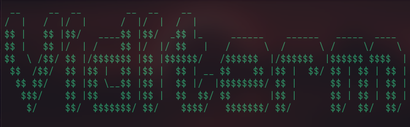

# 
Watch videos in your Linux terminal

# ⚠️ IMPORTANT
You need to install MPV for this to work

For Fedora based distro: 
Enable RPM Fusion and run `'sudo dnf install mpv'`

For Debian based distro:
Run `'sudo apt install mpv'`

# Download
On Linux:

0. See **IMPORTANT**
1. Run `'git clone https://github.com/S3b-sudo/Viditerm'` in the terminal or download the code as a zip
2. Run the install file with `'python install.py'`

On Windows:

¯\_(ツ)_/¯

Maybe try WSL? 

1. Run `'wsl --install'` in powershell or google it if it changed.
2. Follow the Linux portion

## Run

To run the project run `'./run.sh'`
 > If you get Permission denied. Run `'chmod +x run.sh'`

## Usage

Space - Pause

Right Arrow - 5 seconds forward

Left Arrow - 5 seconds back

Ctrl+C - Stop Video

## Screenshots

Default mode

True Askii mode

## Notes
This project is basically just a frount end for mpv in the terminal. It was made to make watching videos in the terminal easy. 
